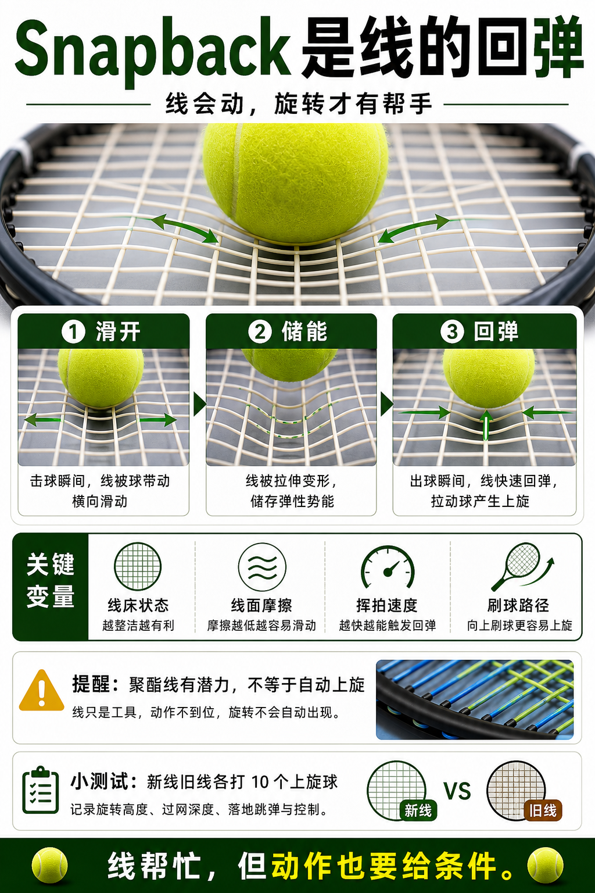

# Snapback 是线的回弹

> 迁移草稿：保留原文供编辑核对，尚未完成面向球友的通用改写和逐条来源复核。

球线被球带动后滑开再回弹，是现代线床帮助产生旋转的重要机制之一。

## 概念说明

Snapback 指击球时球线发生横向滑动，并在出球瞬间回弹。这个过程可以帮助球获得更多旋转。聚酯线常被认为有较好的滑动和回弹潜力，但前提是线床状态、线径、线面摩擦和挥拍速度都合适。没有挥速和合适触球，snapback 不会自动制造上旋。

## 配图

## 常见误区（原版素材）

以为换聚酯线就自动有旋转。

## 理解自测（待编辑）

为什么 snapback 需要线床状态和挥速一起成立？

## 相关词条

- [聚酯线给旋转也给门槛](../equipment/equipment.string.poly.md)（supporting）
- [线床锁死会偷走旋转](../equipment/equipment.string.locked-stringbed.md)（next）

## 来源与审核

- 内容状态：原版标记为 verified（本轮未逐条重新核实）。
- 原始内容：[content/atlas/cards/equipment-deep-dive.json](../../../atlas/cards/equipment-deep-dive.json)；ID：equipment.string.snapback。
- 证据类型：verified-source。
- 来源：[How to choose the right tennis strings](https://blog.tenniswarehouse-europe.com/lc/StringReference.html?lang=en)。
- 原版说明：Supports the string-system cards on polyester, synthetic gut, natural gut, multifilament, gauge, tension, hybrids, stiffness and comfort tradeoffs.
- 原版审核：Codex，2026-05-25。
- Wiki 编辑需检查措辞、适用条件、原版个人化断言及来源支持范围。
