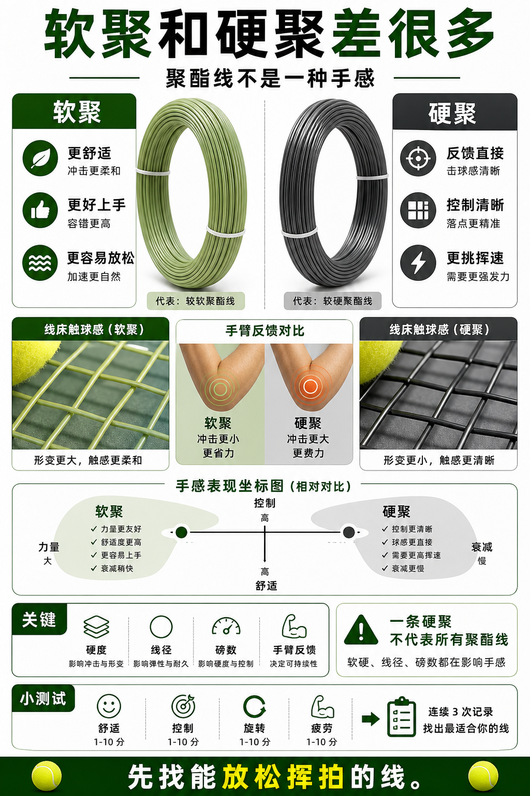

# 软聚和硬聚差很多

> 迁移草稿：保留原文供编辑核对，尚未完成面向球友的通用改写和逐条来源复核。

同样叫聚酯线，软硬差异会显著改变舒适、力量、控制和衰减体验。

## 概念说明

聚酯线不是一个手感。较软的聚酯通常更容易上手，舒适性更好，也更容易让中阶球员放松加速；较硬的聚酯控制和反馈可能更直接，但对挥速和手臂负担要求更高。选聚酯线时不要只看品牌和颜色，要看硬度、线径、磅数和自己是否能放松挥拍。

## 配图

## 常见误区（原版素材）

试过一条硬聚不舒服，就以为所有聚酯线都不适合。

## 理解自测（待编辑）

为什么“聚酯线适不适合我”要细分到软硬？

## 相关词条

- [聚酯线给旋转也给门槛](../equipment/equipment.string.poly.md)（prerequisite）
- [磅数不是越高越控](../equipment/equipment.string.tension.md)（supporting）

## 来源与审核

- 内容状态：原版标记为 verified（本轮未逐条重新核实）。
- 原始内容：[content/atlas/cards/equipment-deep-dive.json](../../../atlas/cards/equipment-deep-dive.json)；ID：equipment.string.soft-vs-stiff-poly。
- 证据类型：verified-source。
- 来源：[How to choose the right tennis strings](https://blog.tenniswarehouse-europe.com/lc/StringReference.html?lang=en)。
- 原版说明：Supports the string-system cards on polyester, synthetic gut, natural gut, multifilament, gauge, tension, hybrids, stiffness and comfort tradeoffs.
- 原版审核：Codex，2026-05-25。
- Wiki 编辑需检查措辞、适用条件、原版个人化断言及来源支持范围。
