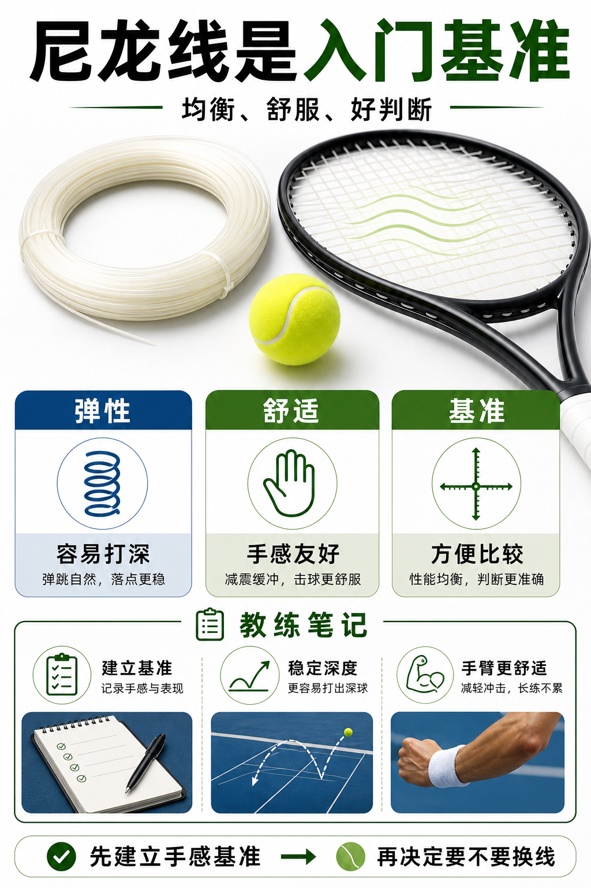

# 尼龙线是最稳的入门基准

> 迁移草稿：保留原文供编辑核对，尚未完成面向球友的通用改写和逐条来源复核。

尼龙线价格友好、手感均衡，适合作为判断自己真正需求的第一条基准线。

## 概念说明

尼龙线常见、便宜、弹性和舒适性比较均衡，是很多球员理解线床手感的起点。它不一定在旋转、耐用或极致控制上突出，但能提供清楚的基准：如果你不知道自己需要什么，先用稳定的尼龙线建立参照，比一开始就追职业配置更可靠。

## 配图

## 常见误区（原版素材）

还没建立基准，就直接追求硬聚、低磅或混线。

## 理解自测（待编辑）

为什么一条普通尼龙线反而适合建立装备基准？

## 相关词条

- [磅数不是越高越控](../equipment/equipment.string.tension.md)（next）
- [装备日志比玄学手感可靠](../equipment/equipment.maintenance.match-log.md)（application）

## 来源与审核

- 内容状态：原版标记为 verified（本轮未逐条重新核实）。
- 原始内容：[content/atlas/cards/equipment-extensions.json](../../../atlas/cards/equipment-extensions.json)；ID：equipment.string.synthetic-gut。
- 证据类型：verified-source。
- 来源：[How to choose the right tennis strings](https://blog.tenniswarehouse-europe.com/lc/StringReference.html?lang=en)。
- 原版说明：Supports the string-system cards on polyester, synthetic gut, natural gut, multifilament, gauge, tension, hybrids, stiffness and comfort tradeoffs.
- 原版审核：Codex，2026-05-25。
- Wiki 编辑需检查措辞、适用条件、原版个人化断言及来源支持范围。
