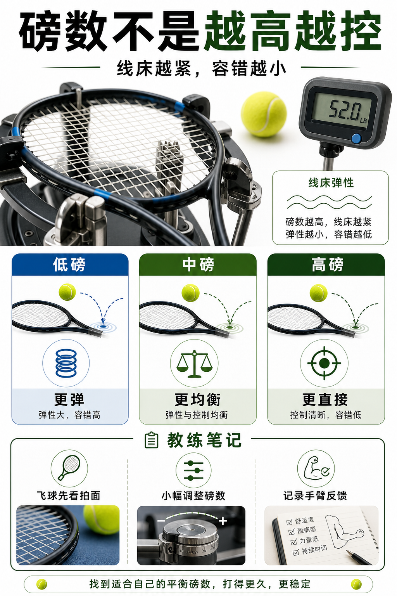

# 磅数不是越高越控

> 迁移草稿：保留原文供编辑核对，尚未完成面向球友的通用改写和逐条来源复核。

磅数改变线床弹性和出球角度，高低都不是绝对答案，要围绕深度、控制和舒适性调整。

## 概念说明

较高磅数通常让线床更紧，出球更直接，控制感更强，但甜区、力量和舒适性可能下降；较低磅数通常更弹、更容易打深，也更舒服，但如果挥拍和拍面管理不稳定，可能觉得球飞。磅数要结合线种：硬聚、尼龙、复丝和天然肠的合理区间和手感完全不同。

## 配图

## 常见误区（原版素材）

一飞就加磅，结果球浅、手臂紧、动作更不放松。

## 理解自测（待编辑）

为什么“飞了就加磅”可能是错误诊断？

## 相关词条

- [聚酯线给旋转也给门槛](../equipment/equipment.string.poly.md)（supporting）
- [装备日志比玄学手感可靠](../equipment/equipment.maintenance.match-log.md)（application）

## 来源与审核

- 内容状态：原版标记为 verified（本轮未逐条重新核实）。
- 原始内容：[content/atlas/cards/equipment-extensions.json](../../../atlas/cards/equipment-extensions.json)；ID：equipment.string.tension。
- 证据类型：verified-source。
- 来源：[How to choose the right tennis strings](https://blog.tenniswarehouse-europe.com/lc/StringReference.html?lang=en)。
- 原版说明：Supports the string-system cards on polyester, synthetic gut, natural gut, multifilament, gauge, tension, hybrids, stiffness and comfort tradeoffs.
- 原版审核：Codex，2026-05-25。
- Wiki 编辑需检查措辞、适用条件、原版个人化断言及来源支持范围。
