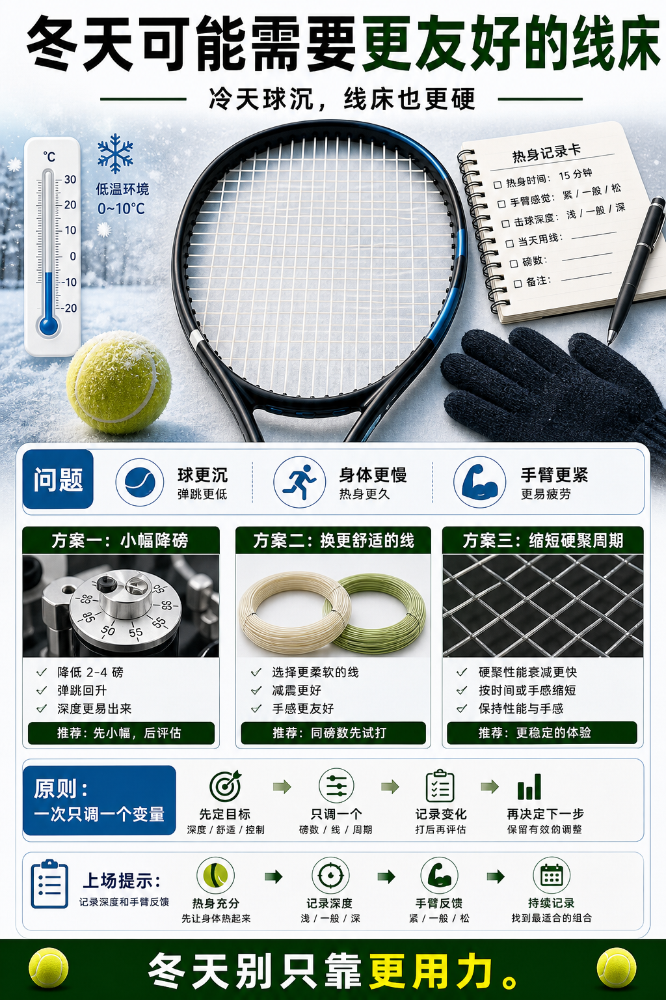

# 冬天可能需要更友好的线床

> 迁移草稿：保留原文供编辑核对，尚未完成面向球友的通用改写和逐条来源复核。

低温下球、线床和身体都更紧，很多人需要用更舒适的线床保护输出。

## 概念说明

冬天球可能更沉，身体热身更慢，线床也可能显得更硬。此时继续使用高磅硬线，可能让深度变浅、手臂更紧。常见思路是适度降低磅数、换更舒适的线或缩短硬聚使用周期。具体调整要小幅、可记录，不能一冷就乱改所有变量。

## 配图

## 常见误区（原版素材）

球浅就更用力，没发现线床和天气都在变硬。

## 理解自测（待编辑）

冬天为什么不能只靠更用力来解决球浅？

## 相关词条

- [冷热天气会改球的活性](../equipment/equipment.ball.temperature.md)（supporting）
- [磅数不是越高越控](../equipment/equipment.string.tension.md)（supporting）

## 来源与审核

- 内容状态：原版标记为 verified（本轮未逐条重新核实）。
- 原始内容：[content/atlas/cards/equipment-deep-dive.json](../../../atlas/cards/equipment-deep-dive.json)；ID：equipment.string.winter-tension。
- 证据类型：source-synthesis。
- 来源：[Fall & Winter Gear Checklist](https://www.tennis-warehouse.com/learning_center/gear_guides/fall-tennis-gear-tips.html)。
- 原版说明：Supports seasonal string and grip adjustment cards by tying cooler conditions to racquet setup, tension and grip changes; used together with the string reference guide.
- 原版审核：Codex，2026-05-25。
- Wiki 编辑需检查措辞、适用条件、原版个人化断言及来源支持范围。
