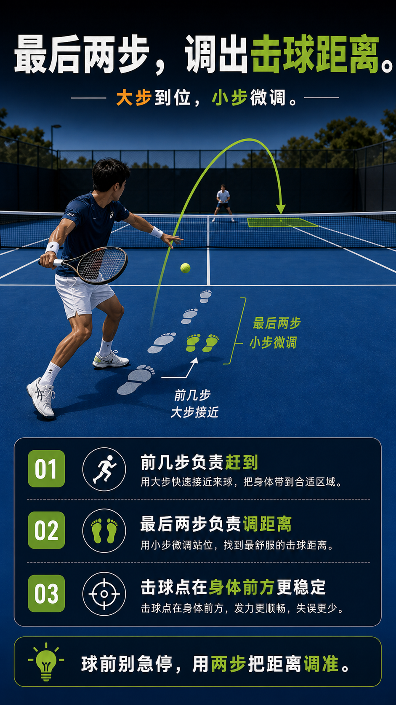

# 最后两步是调距离的微调步

> 迁移草稿：保留原文供编辑核对，尚未完成面向球友的通用改写和逐条来源复核。

接近球时用最后两步做小幅距离微调，而不是大跨步冲进去；微调步决定你击球时是否站稳、距离是否正好。

## 概念说明

到位分两段：大步快速移动覆盖距离，最后两步做精细距离微调。很多被挤到或伸手够球，不是没跑到，而是最后用大跨步冲进去、刹不住、距离全错。把最后两步当成调焦：小、快、稳，让身体停在离球正好的位置再出手。

## 配图

## 常见误区（原版素材）

大步冲到球边刹不住，距离不是太近就是太远，击球失衡。

## 理解自测（待编辑）

到位之后还失衡，问题常出在最后两步是大跨步还是微调步？

## 相关词条

- [击球距离先判断太近、正好、太远](../movement/spacing.contact-distance.md)（prerequisite）
- [弹跳点决定你的击球窗口](../ball-environment/ball.bounce-window.md)（supporting）

## 来源与审核

- 内容状态：原版个人笔记。
- 原始内容：[content/atlas/cards/spacing-movement.json](../../../atlas/cards/spacing-movement.json)；ID：spacing.last-two-steps。
- 尚无独立证据记录；不能从草稿状态自动升为已核实。
- Wiki 编辑需检查措辞、适用条件、原版个人化断言及来源支持范围。
