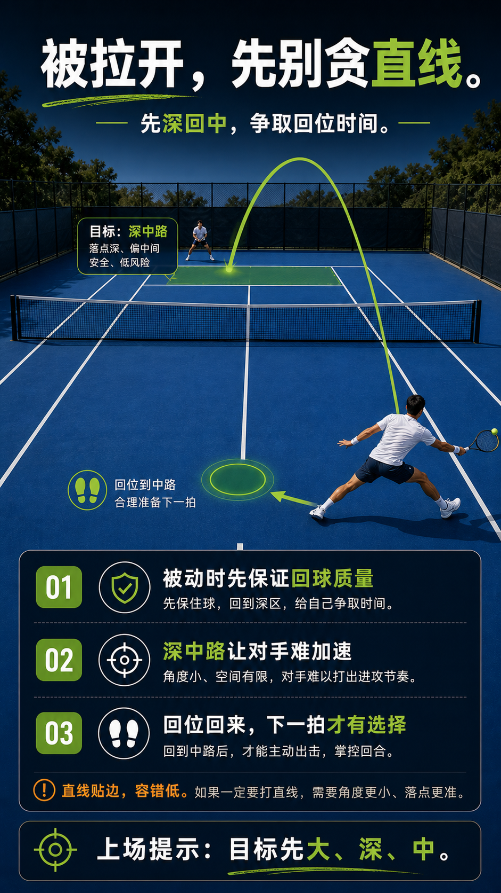

# 被拉到边线，先深回中再谈反攻

> 迁移草稿：保留原文供编辑核对，尚未完成面向球友的通用改写和逐条来源复核。

被拉到边线时，优先打高过网、深回中路争取回位时间，而不是在失衡中追求边线制胜。

## 概念说明

被拉到边线意味着你已经失去场地中心、时间也被压缩。此时打直线制胜既风险高又来不及回位，往往一球送两分。正确做法是用高过网的深中路把对手顶回去，同时全力回位；先把回合拉回中性，再谈反攻。被动球的目标是争取时间，不是逞强。

## 配图

## 常见误区（原版素材）

被拉到边线还硬打直线，球没到位人也回不来，连丢主动。

## 理解自测（待编辑）

被拉到边线时，争取时间和追求制胜哪个才是优先级？

## 相关词条

- [每球之后要回位，不是站着看球](../movement/spacing.recovery-position.md)（prerequisite）
- [深中路：相持中的大目标](../tactics/tactics.deep-middle.md)（application）

## 来源与审核

- 内容状态：原版个人笔记。
- 原始内容：[content/atlas/cards/spacing-movement.json](../../../atlas/cards/spacing-movement.json)；ID：spacing.recover-from-wide。
- 尚无独立证据记录；不能从草稿状态自动升为已核实。
- Wiki 编辑需检查措辞、适用条件、原版个人化断言及来源支持范围。
