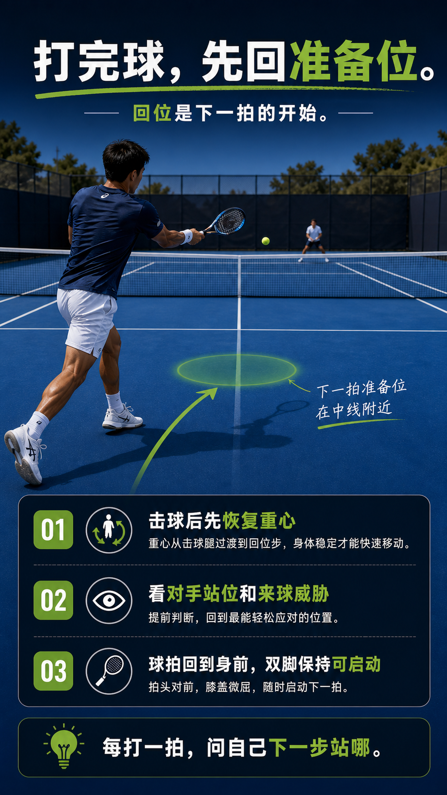

# 每球之后要回位，不是站着看球

> 迁移草稿：保留原文供编辑核对，尚未完成面向球友的通用改写和逐条来源复核。

击球后要主动回到与对手回球角度匹配的最优等待位，而不是停在原地欣赏球，否则下一球必被拉开。

## 概念说明

回位不是机械跑回正中，而是根据自己这球的落点和对手可能的回球角度，回到能覆盖两边的最优等待位。2.7 到 3.5 阶段大量被动是因为击球后停顿、看球落点，等反应过来已经晚一步。回位是回合里最被低估的一步：它决定你下一球是从容还是追球。

## 配图

## 常见误区（原版素材）

击球后停在原地看球，等发现要跑已经慢一步。

## 理解自测（待编辑）

为什么下一球被拉开，问题常常出在上一球之后的哪一步？

## 相关词条

- [Split 不是跳，是落地后能启动](../movement/spacing.split-timing.md)（prerequisite）
- [被拉到边线，先深回中再谈反攻](../movement/spacing.recover-from-wide.md)（next）

## 来源与审核

- 内容状态：原版个人笔记。
- 原始内容：[content/atlas/cards/spacing-movement.json](../../../atlas/cards/spacing-movement.json)；ID：spacing.recovery-position。
- 尚无独立证据记录；不能从草稿状态自动升为已核实。
- Wiki 编辑需检查措辞、适用条件、原版个人化断言及来源支持范围。
