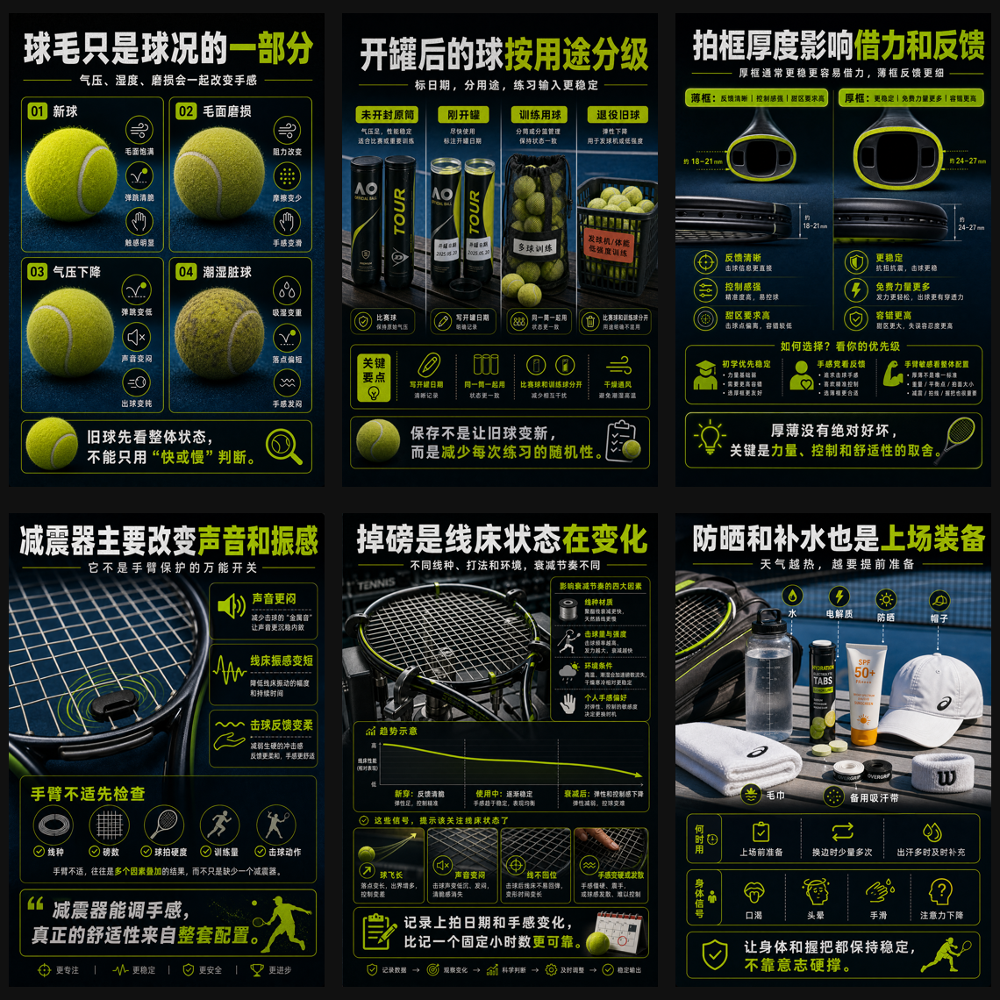
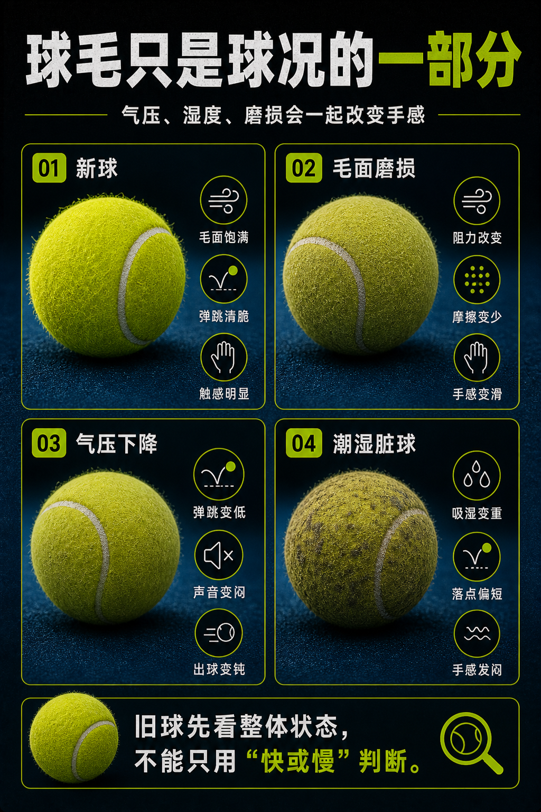
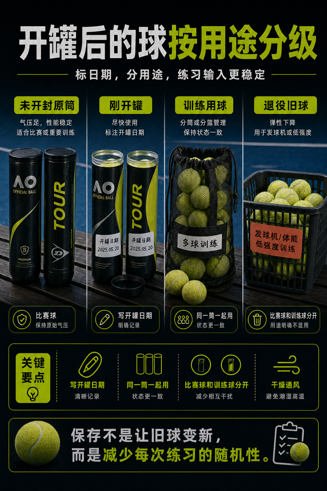
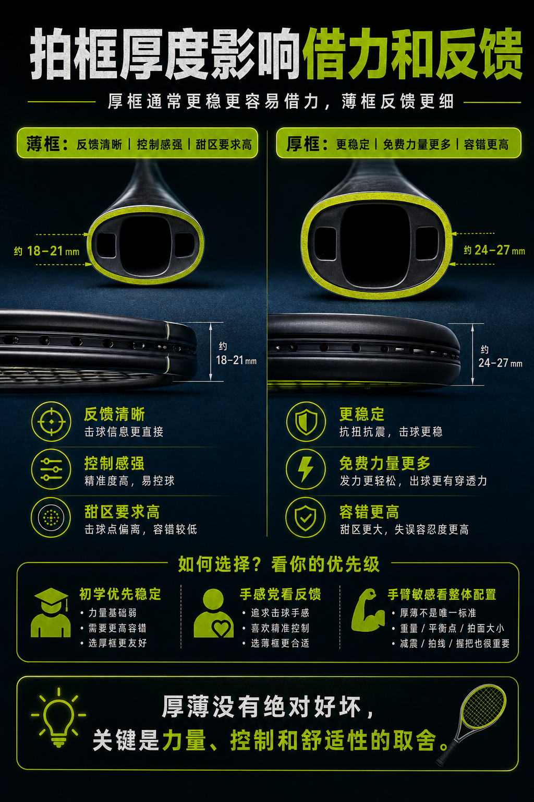
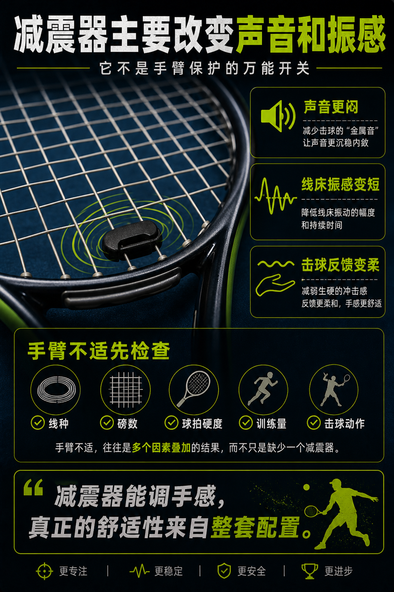
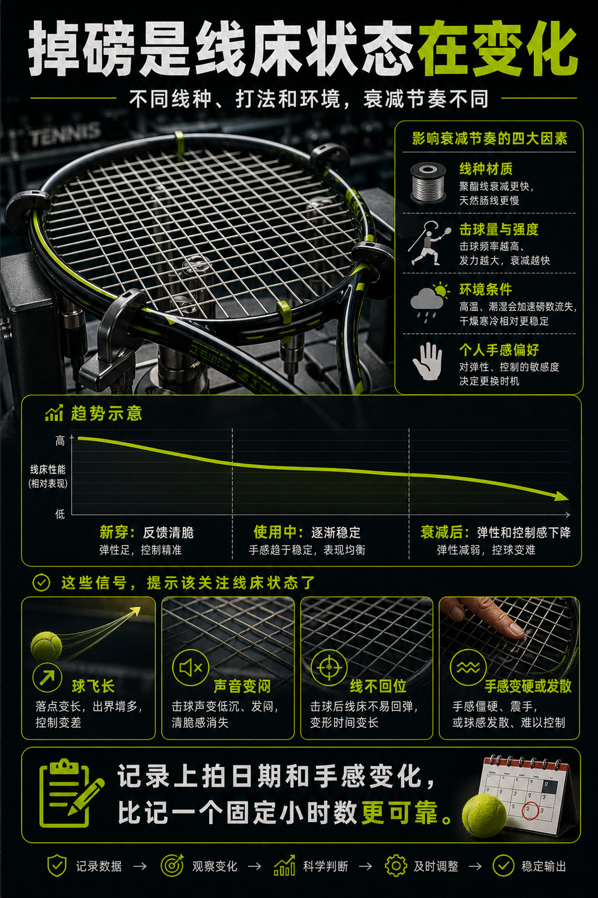
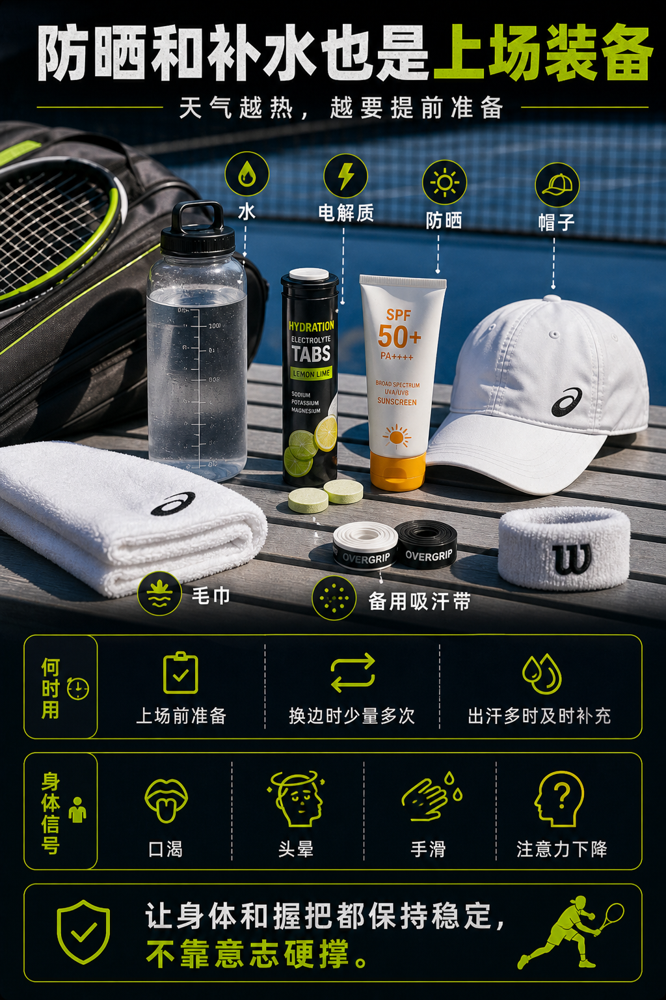

# 装备百科候选图最终确认包（2026-05-25）

这 6 张图已经完成：

- 原失败点复盘：见 `.codex/image-failure-ledger.md`。
- Codex 初审：通过。
- Gemini 外部事实审稿：通过。
- manifest 当前状态：`candidate`。

下一步只做用户最终确认：通过则升为 `approved`；指出问题则退回 `replace` 并记录 ledger。

## App 内确认入口

在本地 app 里可以这样只看这 6 张：

1. 打开 `http://127.0.0.1:5173/`。
2. 进入 `装备百科`。
3. 在 `装备图状态筛选` 里点 `候选图`。
4. 页面应显示 `6 / 62`，只剩下面 6 张候选图。
5. 点任意图进入详情，应看到 `Image Candidate` 和对应 evidence。

## 一屏总览

下面这张是 6 张候选图的审图总览板，方便先快速判断整体风格和明显问题。

如果想逐张看大图和检查项，打开 `equipment-candidate-review-board-2026-05-25.html`。

## 当前候选

| 卡片 | 图片 | 当前判断 | 用户判定 |
|---|---|---|---|
| 球毛决定空气阻力和咬球感 | `public/assets/knowledge/equipment-ball-felt-v1.png` | 重做后把“毛面磨损 / 气压下降 / 潮湿变脏”拆开，Gemini PASS。 | 待确认 |
| 罐装球也需要保存逻辑 | `public/assets/knowledge/equipment-ball-storage-v1.png` | 使用原装球筒、球袋、球篮和用途标签，没有玻璃罐/厨房收纳误导，Gemini PASS。 | 待确认 |
| 拍框厚度改变力量来源 | `public/assets/knowledge/equipment-racquet-beam-v1.png` | 改为厚框通常更稳、更容易借力；没有再写厚框形变大储能，Gemini PASS。 | 待确认 |
| 减震器主要改声音和手感 | `public/assets/knowledge/equipment-accessory-dampener-v1.png` | 明确减震器主要改变声音和振感；没有 KG/kg 张力图标，Gemini PASS。 | 待确认 |
| 掉磅会让线床换性格 | `public/assets/knowledge/equipment-string-tension-loss-v1.png` | 使用“趋势示意”和定性阶段，没有通用百分比/小时曲线，Gemini PASS。 | 待确认 |
| 防晒和补水也是装备 | `public/assets/knowledge/equipment-accessory-sun-hydration-v1.png` | 改为装备清单和身体信号，没有固定每小时毫升数，Gemini PASS。 | 待确认 |

## 逐张图片

### 1. 球毛决定空气阻力和咬球感

最终确认重点：

- 是否避免了“旧球毛磨平 = 一定更快”的误导。
- 是否清楚区分球毛、气压和湿度。
- 文字是否清楚且没有内部矛盾。

### 2. 罐装球也需要保存逻辑

最终确认重点：

- 是否像网球装备管理，而不是生活收纳。
- 是否清楚表达原筒日期、训练分级和用途标签。
- 是否避免承诺“保存能让旧球变新”。

### 3. 拍框厚度改变力量来源

最终确认重点：

- 厚框/薄框的取舍是否准确。
- 是否没有再出现厚框“形变大、储能更多”的错误机制。
- 是否适合作为装备百科入门图。

### 4. 减震器主要改声音和手感

最终确认重点：

- 是否明确减震器不是手臂保护万能开关。
- 是否把不适排查放回线种、磅数、球拍硬度、训练量和动作。
- 是否没有 KG/kg 之类单位误导。

### 5. 掉磅会让线床换性格

最终确认重点：

- 是否只表达趋势，而不是伪精确曲线。
- 是否没有通用百分比和固定小时数。
- 判断信号是否可执行：飞长、声音、回位、手感。

### 6. 防晒和补水也是装备

最终确认重点：

- 是否从“健康处方”回到“上场装备准备”。
- 是否没有固定补水毫升数。
- 是否清楚表达换边少量多次、出汗及时补充和手滑/注意力信号。

## 通过后的落盘动作

如果用户确认 6 张都通过：

1. 运行 `npm run equipment:finalize -- --apply --confirm-user-approved`。
2. 脚本会将这 6 条 manifest 状态从 `candidate` 改为 `approved`，并更新 `equipment-encyclopedia-readiness-audit-2026-05-25.md`：`approved = 62`，`candidate = 0`。
3. 跑：
   - `npm run equipment:audit -- --strict-approved`
   - `npm run test -- --run`
   - `npm run typecheck`
   - `npm run build`
4. 重新做完成度审计；只有全部证据都成立，才允许把装备百科初版标记完成。
